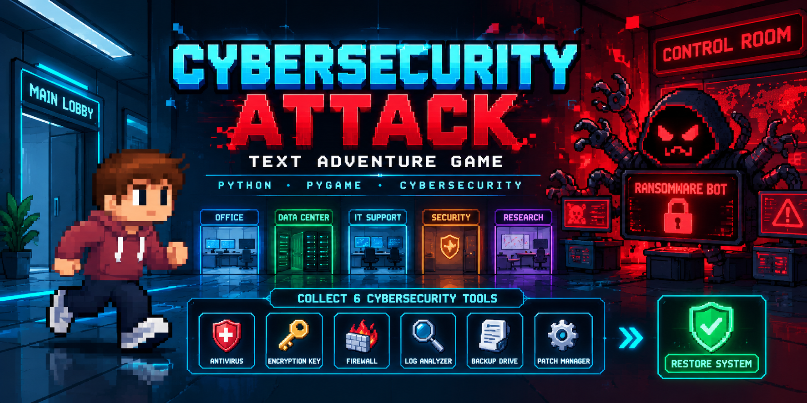
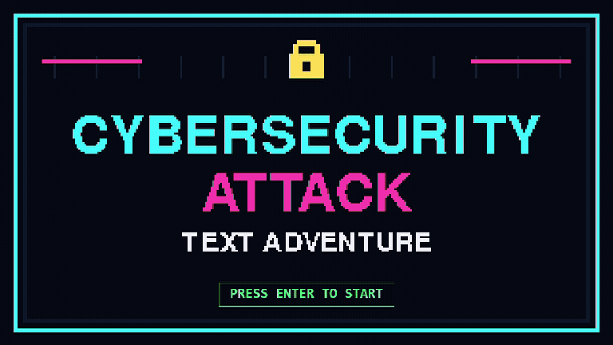
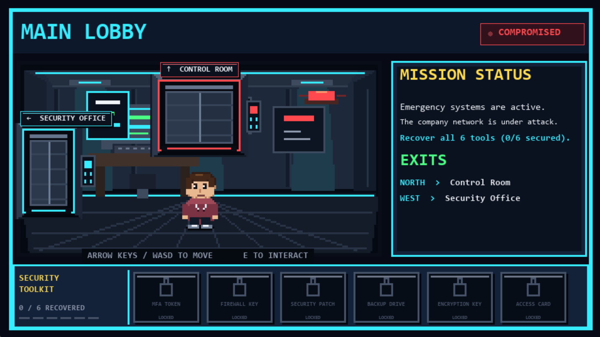
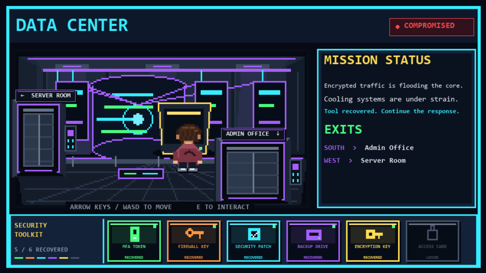
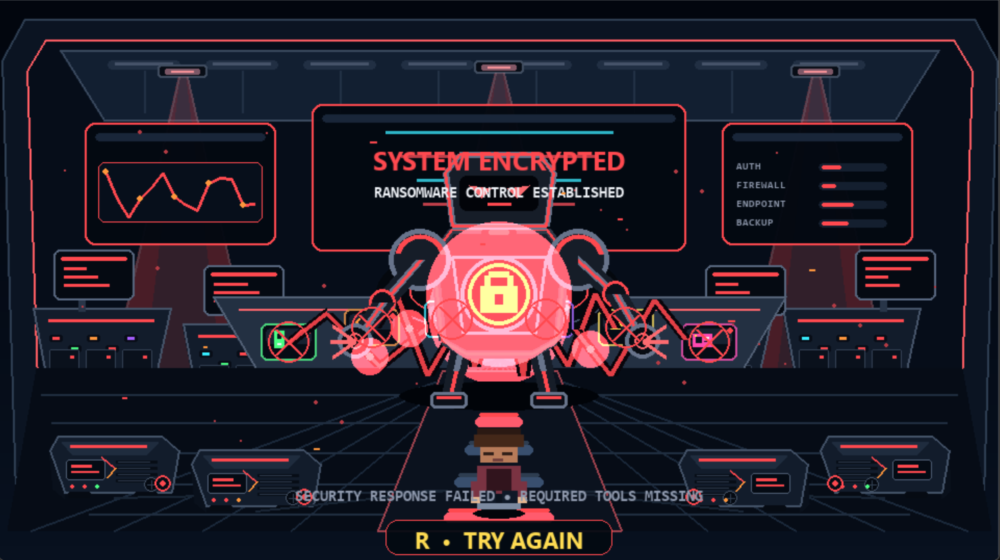
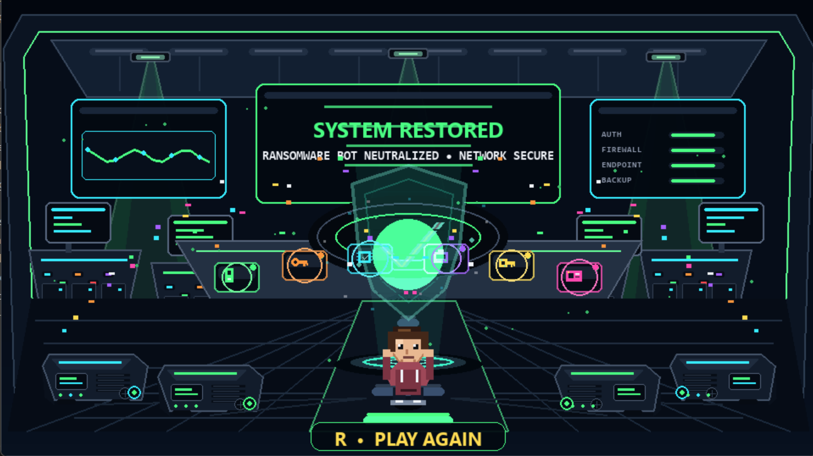

# Cybersecurity Attack

A Python/Pygame cybersecurity adventure game where the player takes the role of a cybersecurity analyst responding to an active ransomware attack.

Navigate through a compromised technology facility, recover six cybersecurity tools, and reach the Control Room to stop the Ransomware Bot before the system is lost.

This repository contains both the **original academic text-based project** and a separately developed **enhanced portfolio version** featuring graphical environments, animated gameplay, visual inventory tracking, cinematic win/loss sequences, and sound effects.

---

## Gameplay Preview



---

## Enhanced Portfolio Version

The enhanced version transforms the original terminal-based Python project into a visual Pygame experience while preserving the core navigation, inventory, item collection, and win/loss logic.

### Features

- Eight-room cybersecurity facility
- Real-time player movement
- Arrow key and WASD controls
- Directional character artwork
- Detailed pixel-art environments
- Animated room transitions
- Six collectible cybersecurity tools
- Visual Security Toolkit inventory
- Mission status interface
- Interactive item recovery
- Ransomware Bot confrontation
- Cinematic victory and defeat sequences
- Confetti and system-restoration effects
- Cybersecurity-themed lighting and interface design
- Sound effects for interactions and major game events
- Mute/unmute control
- Restart and replay functionality
- Input validation and game-state management

---

## Gameplay Showcase

### Explore the Facility



### Recover Cybersecurity Tools



### Ransomware Takes Control



### System Restored



---

## Mission

A ransomware attack has compromised the company's systems.

The player is a cybersecurity analyst responsible for recovering the security tools needed to restore the environment and stop the attack.

Six tools are distributed throughout the facility:

- MFA Token
- Firewall Key
- Security Patch
- Backup Drive
- Encryption Key
- Access Card

The player must collect all six tools before entering the **Control Room**.

Entering the Control Room too early allows the **Ransomware Bot** to take control of the system.

Recovering every tool before entering the Control Room allows the player to neutralize the ransomware attack and restore the network.

---

## Game Map

The game contains eight connected rooms.

| Room | Item / Role |
| --- | --- |
| Main Lobby | Starting Room |
| Security Office | MFA Token |
| Network Operations Center | Firewall Key |
| IT Office | Security Patch |
| Server Room | Backup Drive |
| Data Center | Encryption Key |
| Admin Office | Access Card |
| Control Room | Ransomware Bot |

### Visual Map


The editable Draw.io version is preserved at:

```text
original/game_map.drawio
```

---

## Controls

| Control | Action |
| --- | --- |
| `Enter` | Start game |
| `Arrow Keys` / `WASD` | Move character |
| `E` | Interact / collect item |
| `M` | Mute or unmute sound |
| `R` | Restart after win/loss |
| `Esc` | Return to title screen |

---

## Running the Enhanced Game

### Requirements

- Python 3
- pygame-ce

Install pygame-ce if needed:

```bash
py -m pip install pygame-ce
```

Clone or download the repository, then run:

```bash
py enhanced/main.py
```

If your system uses `python` instead of `py`:

```bash
python enhanced/main.py
```

---

## Sound Design

The enhanced version includes custom sound effects for:

- Item pickup
- Room transitions
- Interface interactions
- Ransomware warnings
- Victory / system restoration

The sound files are stored in:

```text
enhanced/assets/sounds/
```

Press `M` during gameplay to mute or unmute audio.

---

## Original Academic Version

This project was originally developed for **IT 140: Introduction to Scripting** at Southern New Hampshire University.

The original version is preserved separately so the completed academic project remains available alongside the enhanced portfolio edition.

The original development process included:

- Game storyboard development
- Room-map planning
- Movement pseudocode
- Item-collection pseudocode
- Navigation logic
- Inventory management
- Input validation
- Win/loss logic
- Testing and debugging

The final Project Two submission earned **140/140**.

The original files are located in:

```text
original/
```

---

## Original Text-Based Controls

The original academic version uses terminal commands.

### Movement

```text
go north
go south
go east
go west
```

### Collect an Item

```text
get <item name>
```

Example:

```text
get MFA Token
```

---

## Original Game Screenshots

### Game Instructions and Starting Room


### Room Navigation


### Item Collection


### Input Validation


### Losing Condition


### Winning Condition


---

## Python Concepts Demonstrated

The project demonstrates practical use of:

- Python functions
- Dictionaries
- Lists
- Loops
- Conditional statements
- User input
- String processing
- Input validation
- Inventory management
- Program and game-state control
- Event handling
- Game loops
- Movement and collision logic
- Animation timing
- Audio playback
- Debugging
- Testing
- Pygame graphics

---

## Testing

Both versions were tested across multiple gameplay scenarios.

Testing included:

- Valid room movement
- Invalid movement attempts
- Successful item collection
- Incorrect interactions
- Inventory updates
- Room transitions
- Character movement
- Entering the Control Room too early
- Winning after collecting all six tools
- Restart behavior
- Returning to the title screen
- Sound playback
- Mute/unmute functionality

A complete winning route was also tested through all six item locations before entering the Control Room.

---

## Development Process

The project evolved through several stages:

1. Created the cybersecurity ransomware storyline
2. Designed the eight-room environment
3. Created the game storyboard and room map
4. Wrote movement pseudocode
5. Wrote item-collection pseudocode
6. Developed the original terminal-based Python game
7. Added inventory tracking and input validation
8. Implemented win and loss conditions
9. Preserved the completed academic version
10. Created a separate enhanced Pygame version
11. Added graphical room environments
12. Added real-time player movement
13. Redesigned the player character and directional views
14. Added the visual Security Toolkit inventory
15. Added animated room transitions and interactions
16. Redesigned the Control Room and Ransomware Bot confrontation
17. Added cinematic victory and defeat sequences
18. Added visual effects, confetti, and system restoration
19. Added sound effects and mute controls
20. Added a GitHub banner, gameplay GIF, and final screenshots

This progression demonstrates how an initial scripting assignment was expanded into a more complete Python game-development portfolio project.

---

## Project Structure

```text
cybersecurity-text-adventure-game/
│
├── README.md
│
├── docs/
│   ├── cybersecurity-attack-banner.png
│   ├── cybersecurity-attack-gameplay.gif
│   └── game_map.png
│
├── enhanced/
│   ├── main.py
│   └── assets/
│       ├── sprites/
│       └── sounds/
│           ├── pickup.wav
│           ├── transition.wav
│           ├── ui_click.wav
│           ├── victory.wav
│           └── warning.wav
│
├── original/
│   ├── text_based_game.py
│   ├── game_map.drawio
│   ├── game_storyboard.md
│   ├── move.pseudo
│   └── get_item.pseudo
│
└── screenshots/
    ├── 01-game-instructions.png
    ├── 01-main-lobby-final.png
    ├── 02-room-navigation.png
    ├── 02-data-center-final.png
    ├── 03-item-collection.png
    ├── 03-loss-final.png
    ├── 04-invalid-command.png
    ├── 04-victory-final.png
    ├── 05-losing-screen.png
    └── 06-winning-screen.png
```

---

## Possible Next Steps

The main desktop game is complete. Possible future expansion could include:

- Browser-based deployment
- Touch controls for mobile devices
- Responsive layouts for different screen sizes
- Additional cybersecurity missions
- Additional rooms or levels
- Packaged desktop releases
- Mobile application deployment

---

## Academic Project Note

This project originated from an academic programming assignment and was later independently expanded into an enhanced portfolio project.

The repository preserves the original academic implementation while separately documenting the additional development, game design, interface, animation, audio, debugging, and testing work completed afterward.

Course assignment instructions, grading rubrics, templates, and other course materials are not included in this public repository.

---

## Author

**Hamzah A.**