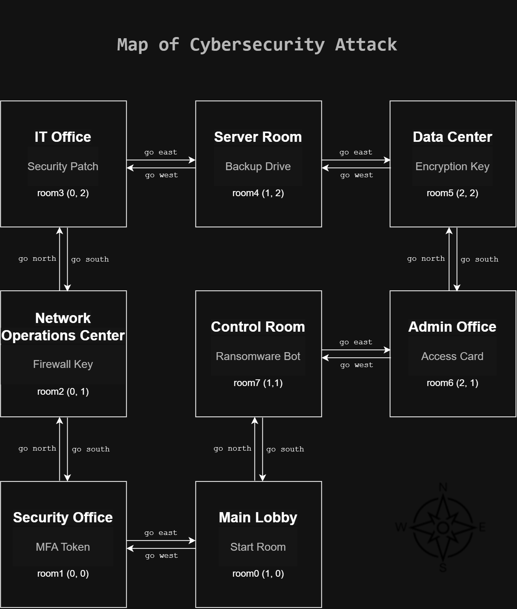
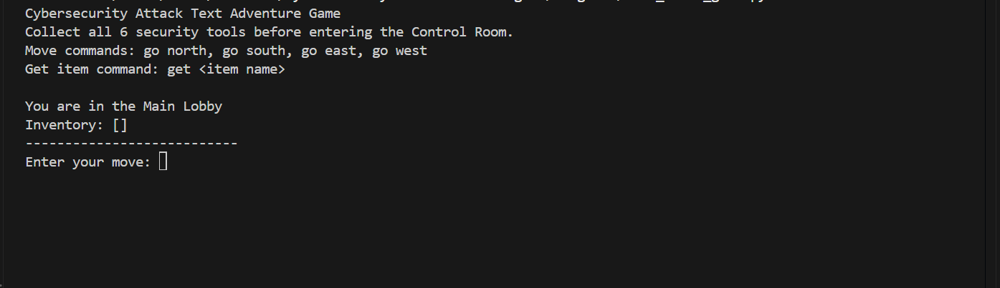
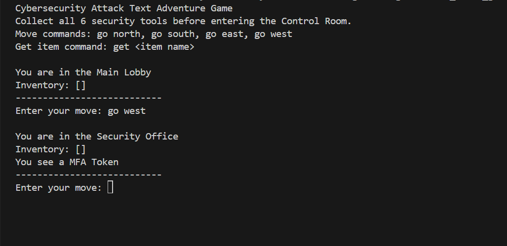
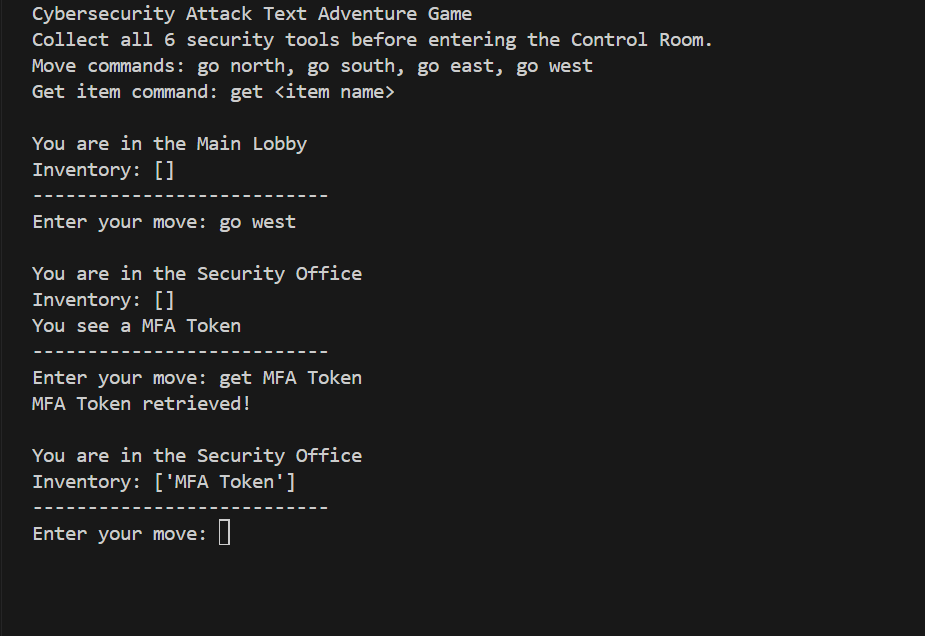
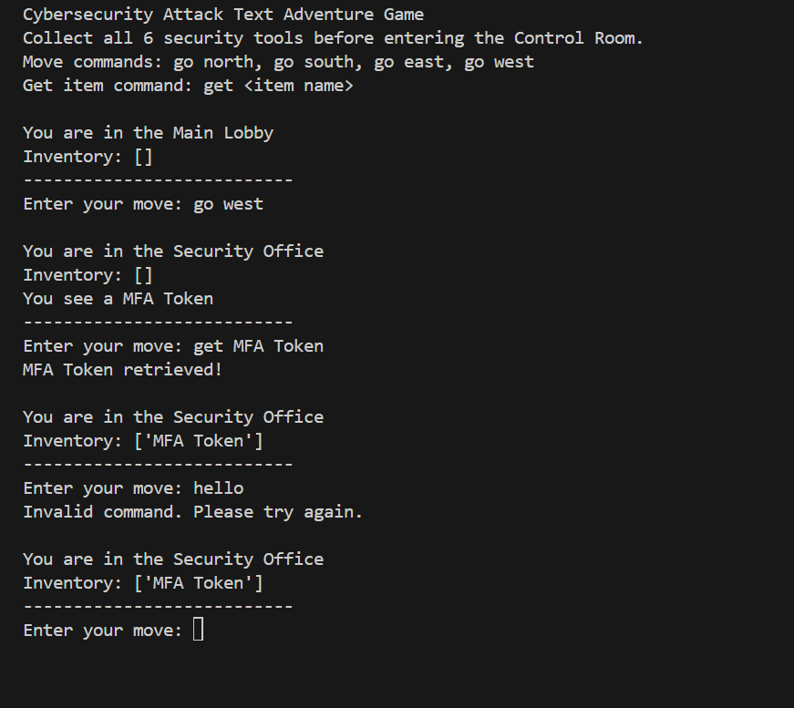
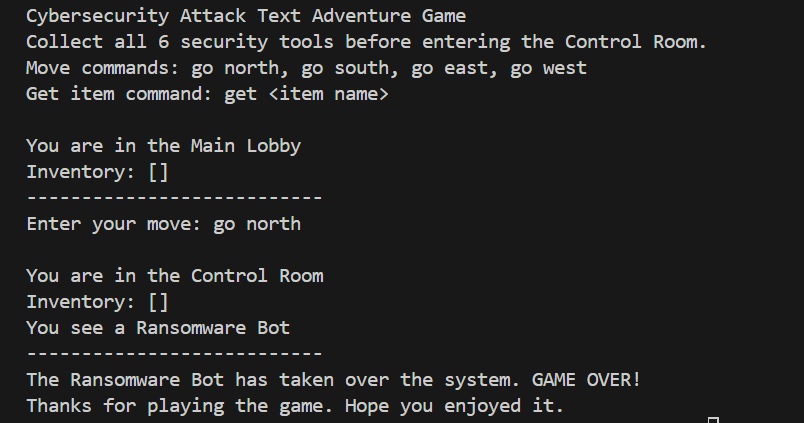
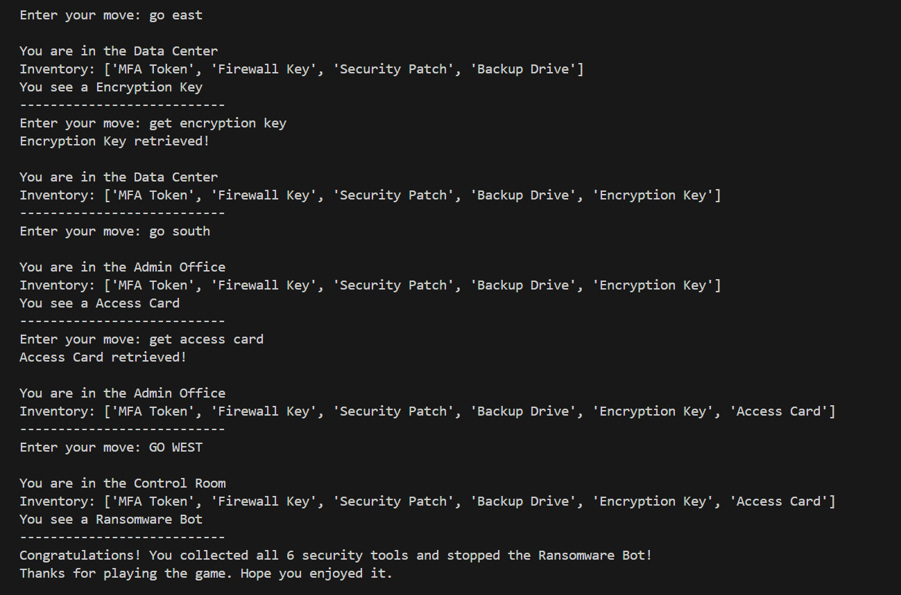

# Cybersecurity Attack Text Adventure Game

A Python text-based adventure game where the player takes the role of a cybersecurity analyst responding to a ransomware attack.

The objective is to navigate through a company environment, collect six cybersecurity tools, and reach the Control Room only after collecting every item. Entering the Control Room too early results in a loss.

## Project Overview

This project was originally developed as part of **IT 140: Introduction to Scripting** at Southern New Hampshire University.

The project began with planning and design, including a game storyboard, room map, and pseudocode. The design was then developed into a fully functional Python text-based game using functions, dictionaries, lists, loops, conditional statements, user input, and input validation.

The final Project Two submission earned **140/140**.

## Story

A ransomware attack has taken control of the company's systems.

The player is a cybersecurity analyst responsible for stopping the attack. Before entering the Control Room and confronting the **Ransomware Bot**, the player must collect six security tools located throughout the building.

Entering the Control Room before collecting all six tools allows the ransomware attack to succeed.

## Objective

Collect all six cybersecurity tools:

- MFA Token
- Firewall Key
- Security Patch
- Backup Drive
- Encryption Key
- Access Card

After collecting all six items, enter the **Control Room** to stop the Ransomware Bot.

## Game Map

The game contains eight rooms:

| Room | Item / Role |
| --- | --- |
| Main Lobby | Starting Room |
| Security Office | MFA Token |
| Network Operations Center | Firewall Key |
| IT Office | Security Patch |
| Server Room | Backup Drive |
| Data Center | Encryption Key |
| Admin Office | Access Card |
| Control Room | Ransomware Bot |

### Visual Map



The editable Draw.io version is available at:

`original/game_map.drawio`

## Game Commands

Players interact with the original version of the game through text commands.

### Movement

```text
go north
go south
go east
go west
```

### Collect an Item

```text
get <item name>
```

Example:

```text
get MFA Token
```

## Features

- Eight-room game environment
- Room-based navigation
- Six collectible cybersecurity tools
- Inventory tracking
- Item collection
- Direction validation
- Invalid-command handling
- Player status display
- Win and loss conditions
- Functions for organizing gameplay
- Dictionary-based room and item system

## Python Concepts Demonstrated

This project demonstrates the use of:

- Python functions
- Dictionaries
- Lists
- `while` loops
- `if`, `elif`, and `else` statements
- User input
- String processing
- Input validation
- Inventory management
- Program flow control
- Debugging and testing
- Comments and descriptive naming conventions

## Gameplay

### Game Instructions and Starting Room

The game begins in the **Main Lobby** with an empty inventory. The player receives the objective and available commands.



### Room Navigation

Players move between connected rooms using directional commands. In this example, the player moves west from the Main Lobby to the Security Office.



### Item Collection and Inventory

Items can be collected using the `get <item name>` command. After an item is collected, it is added to the player's inventory and removed from the room.



### Input Validation

The game detects commands that do not match a valid movement or item command and allows the player to continue playing.



### Losing Condition

Entering the Control Room before collecting all six security tools causes the Ransomware Bot to take over the system.



### Winning Condition

After collecting all six cybersecurity tools, the player can safely enter the Control Room and stop the Ransomware Bot.



## Testing

The game was tested across multiple scenarios to verify its functionality.

Testing included:

- Valid room movement
- Invalid room movement
- Successful item collection
- Incorrect item requests
- Completely invalid commands
- Inventory updates
- Losing by entering the Control Room too early
- Winning after collecting all six cybersecurity tools

A complete winning route was tested from the Main Lobby through all six item locations before entering the Control Room.

## Project Structure

```text
cybersecurity-text-adventure-game/
│
├── README.md
│
├── original/
│   ├── text_based_game.py
│   ├── game_map.drawio
│   ├── game_storyboard.md
│   ├── move.pseudo
│   └── get_item.pseudo
│
├── docs/
│   └── game_map.png
│
└── screenshots/
    ├── 01-game-instructions.png
    ├── 02-room-navigation.png
    ├── 03-item-collection.png
    ├── 04-invalid-command.png
    ├── 05-losing-screen.png
    └── 06-winning-screen.png
```

The original folder contains a portfolio-ready copy of the completed academic project before future gameplay enhancements are introduced.

## Running the Original Game

### Requirements

- Python 3

### Run the Game

Clone or download the repository.

From the project folder, run:

```bash
python original/text_based_game.py
```

Then follow the instructions displayed in the terminal.

## Development Process

The project was developed in stages:

1. Created the cybersecurity theme and storyline
2. Designed the eight-room environment
3. Created pseudocode for room movement
4. Created pseudocode for item collection
5. Developed and tested a simplified navigation prototype
6. Converted the design into a complete Python game
7. Added inventory and item collection
8. Added input validation
9. Added win and loss conditions
10. Tested multiple gameplay scenarios

This development process demonstrates how requirements, pseudocode, planning, debugging, and testing can be translated into a functional Python application.

## Future Enhancements

The portfolio-ready version of the original academic project will remain preserved while an enhanced version of the game is developed separately.

Planned improvements include:

- Web-based user interface
- Clickable movement controls
- Visual inventory panel
- Improved room descriptions
- Cybersecurity-themed graphics
- Improved story interactions
- Restart and replay options
- Enhanced win and loss screens
- Optional sound effects
- Improved mobile usability
- Online deployment so anyone can play through a web browser

## Academic Project Note

This project originated from an academic programming assignment and has been preserved as part of my software development portfolio.

The repository is intended to showcase my own game design, planning, Python development, debugging, and testing work.

Course assignment instructions, grading rubrics, templates, and other course materials are not included in the public repository.

## Author

**Hamzah A.**